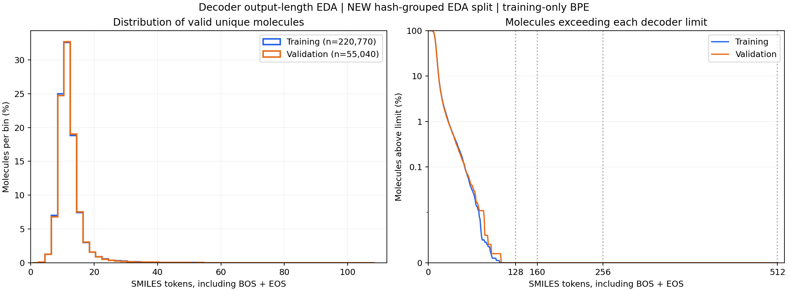

# Decoder-length EDA

The results below describe the original supplied SMILES and 80/20 EDA split.
The generator now uses competition-normalized targets and identity partitions
from `../casmi_generative_ranker/molecular_preprocessing.py`. Recompute token
lengths on those targets with the exact training-only tokenizer before choosing
the production decoder limit; the saved EDA tokenizer is historical.

Open `smiles_length_eda.ipynb` for the self-contained local/Colab analysis and
saved outputs. The companion script runs the same analysis from the command line:

```bash
python eda/smiles_length_eda.py \
  --train ../enveda-CASMI26-molecule-id-mass-spectra/train.parquet
```

Dependencies: `numpy pandas pyarrow matplotlib rdkit tokenizers`. The notebook
installs missing packages. To check the analysis logic:

```bash
python -m unittest discover -s eda -p 'test_smiles_length_eda.py' -v
```

The scan reads only molecular identity and SMILES columns. It fits a 512-token BPE
vocabulary on valid training representatives, then measures untruncated sequences
including BOS/EOS. Each `inchikey14` contributes once. When several strings share
an identity, the lexicographically smallest nonempty supplied SMILES is chosen;
strings are not canonicalized. Supplied identities are not chemically verified or
restandardized, and `inchikey14` can group stereoisomers.

The default seed-42 hash-grouped 80/20 EDA partition matches the default
peak-retention notebook. **It does not reproduce the generator's three-way split.**
Use `--split-lookup path.json` (or notebook `SPLIT_LOOKUP`) with a complete mapping
of identities to `Training`/`Validation` to analyze an existing split. Use original
unfiltered targets; length-filtered training artifacts would conceal the tail.

## Full dataset results

The scan covered all 2,539,608 spectra and 275,810 unique supplied identities.
There were no missing identities or empty SMILES. There were 1,612 identities with
multiple supplied SMILES (277,566 identity/SMILES pairs before representative
selection). Results below describe the selected representatives.

| Split | Unique molecules | Median | P95 | P99 | Maximum |
|---|---:|---:|---:|---:|---:|
| Training | 220,770 | 11 | 18 | 30 | 105 |
| Validation | 55,040 | 11 | 18 | 30 | 107 |

Both splits have **0%** exceeding 128, 160, 256, or 512 tokens. Invalid/missing
SMILES rates, unknown content-token rates, molecules containing unknown tokens,
and decode/encode roundtrip failures are all **0%** among these representatives.
For this split and fitted tokenizer, a 128-token budget covers every observed
target. Recheck with the exact model training split/tokenizer before changing
the generator configuration; no model setting is changed by this EDA.



`smiles_length_results/` contains the plot, a summary CSV, the per-molecule audit
CSV, the fitted tokenizer, and a JSON scan report recording configuration,
denominators, and package versions. Percentiles use linear interpolation. Invalid
rates use all unique identities in each split; lengths and exceedance rates use
valid representatives only. Unknown-token percentages use content tokens,
excluding BOS/EOS. Over-limit means **strictly greater than** the limit.

These coverage results do not guarantee valid generated SMILES or bound future
targets. Keep explicit over-limit handling and avoid silently truncating molecular
structures. Different tokenizer vocabularies produce different lengths.
