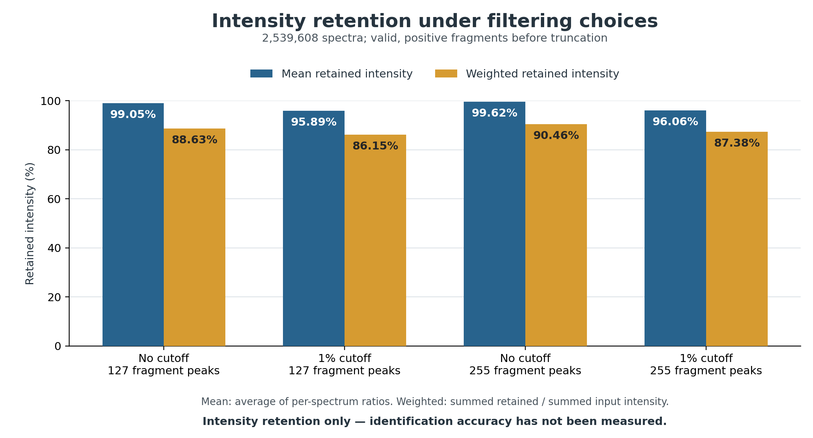
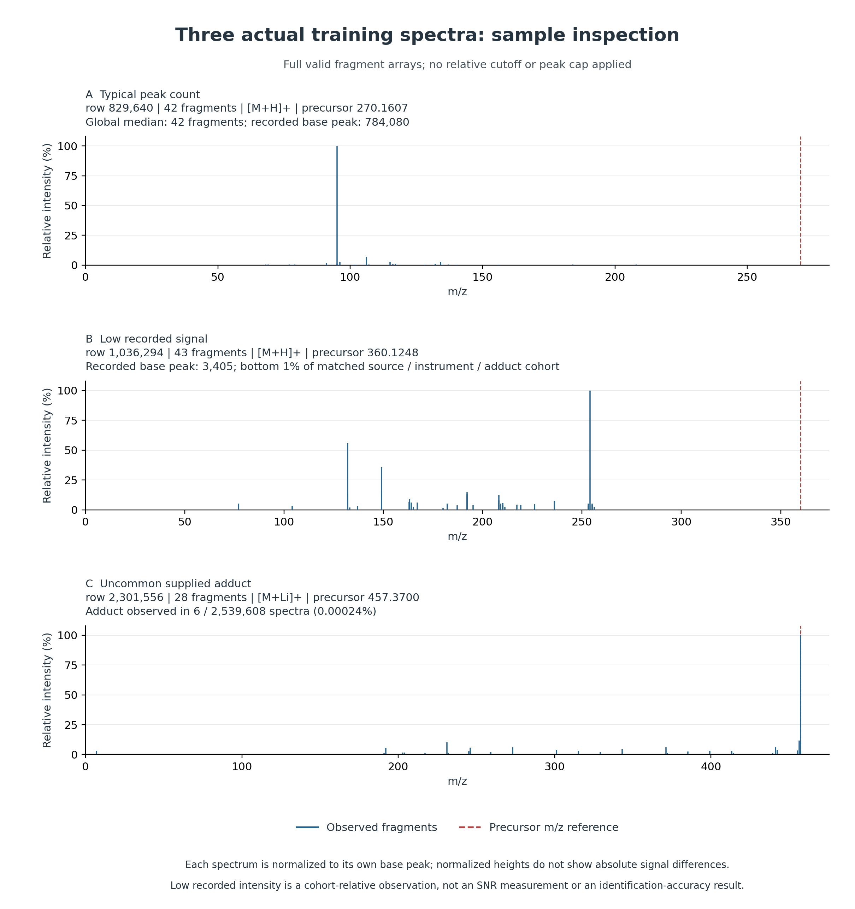

# Phase 3 CPU preprocessing audit

Full source scan: **2,539,608 training-file records**, with saved generator-training, validation and ranker-holdout identities. No model training or prediction-accuracy comparison was performed.

## Before/after audit

Before record-level counts cover all source rows; after counts cover the baseline-usable view, except the immutable source-row total. Fragment-pair counts use the same usable cohort before and after. Reasons can overlap and must not be summed as disjoint record counts.

| Measure | Before | After baseline cleaning | Action / status |
|---|---:|---:|---|
| Source records (immutable) | 2,539,608 | 2,539,608 | Original file preserved; all source rows audited |
| Records available in cleaned baseline view | 2,539,608 | 2,539,608 | Exclude only quarantined records from the usable view |
| Invalid molecular-target rows | 0 | 0 | Reuse saved invalid status; quarantine |
| Invalid precursor rows | 0 | 0 | Quarantine; do not infer precursor |
| Unusable/misaligned fragment-array rows | 0 | 0 | Quarantine; do not guess peak alignment |
| Invalid fragment pairs (usable cohort) | 0 | 0 | Remove nonfinite, nonpositive-m/z or negative-intensity pairs |
| Zero-intensity fragment pairs (usable cohort) | 0 | 0 | Remove noninformative zero pairs, matching existing input preparation |
| Exact record duplicate excess rows | 501 | 501 | Retain and flag; repeated molecules alone are not duplicates |
| Missing adduct rows | 0 | 0 | Retain and flag; no imputation |
| Unknown-placeholder adduct rows | 0 | 0 | Retain original value and flag separately from missing |
| Missing ionization_mode rows | 0 | 0 | Retain and flag; no imputation |
| Unknown-placeholder ionization_mode rows | 0 | 0 | Retain original value and flag separately from missing |
| Missing instrument_type rows | 33,350 | 33,350 | Retain and flag; no imputation |
| Unknown-placeholder instrument_type rows | 1,348 | 1,348 | Retain original value and flag separately from missing |
| Missing usable collision-energy rows | 337,443 | 337,443 | Retain and flag missingness |
| Invalid collision-energy values (usable cohort) | 0 | 0 | Ignore nonfinite/negative components, matching existing metadata preparation |
| Spectra below sparse flag (aligned usable cohort) | 207,577 | 207,577 | Retain and flag; before counts supplied entries, after counts positive valid fragments |
| Precursor-only usable spectra | 0 | 0 | Retain and flag; no positive fragment signal |
| Usable spectra with repeated m/z values | 682 | 682 | Retain and flag; no peak merging |
| Usable spectra with above-precursor fragments | 1,217,023 | 1,217,023 | Retain and flag; no above-precursor deletion rule |

Quarantined records: **0**. Cleaned correction patches: **0**. Quarantined source records remain recoverable from the immutable source file and audit row index; no ambiguous record is silently repaired. The baseline uses no relative-intensity cutoff.

## Filtering experiments: four arms

All four arms start from the same baseline-usable cohort and the same finite, positive, untruncated fragment pairs. The 1% arm removes values strictly below 1% of that spectrum's base peak, before applying the fragment cap; values exactly at 1% remain. 127 and 255 are **fragment counts**, corresponding to 129 and 257 total Transformer positions after precursor and metadata. These are experiments, not adopted cleaning rules.

| Cutoff | Fragment cap | Eligible spectra | Affected spectra | Peaks removed by cutoff | Peaks removed by cap | Total peaks removed | Mean retained intensity | Weighted retained intensity |
|---|---:|---:|---:|---:|---:|---:|---:|---:|
| 0% | 127 | 2,539,608 | 744,469 | 0 | 247,740,523 | 247,740,523 | 99.0510% | 88.6281% |
| 1% | 127 | 2,539,608 | 1,833,775 | 322,513,846 | 24,522,962 | 347,036,808 | 95.8865% | 86.1466% |
| 0% | 255 | 2,539,608 | 447,178 | 0 | 173,609,821 | 173,609,821 | 99.6223% | 90.4605% |
| 1% | 255 | 2,539,608 | 1,818,043 | 322,513,846 | 20,755,413 | 343,269,259 | 96.0624% | 87.3787% |

Counts affected by cutoff and cap are also recorded separately in filtering_experiments.csv, overall and by the three saved partitions. Mean retention averages per-spectrum ratios; weighted retention divides summed retained intensity by summed valid input intensity. The artificial precursor and invalid/zero pairs are excluded from both intensity denominators. Precursor-only spectra remain in record/peak counts but have undefined intensity retention. Retained intensity is not retained chemical information: weak diagnostic fragments may matter.

<!-- retention-figure:start -->


**Intensity retention, not identification accuracy.** The 0–100% axis is shared by both series. Mean retention averages per-spectrum ratios; weighted retention uses summed intensities. Both series use the same full audit cohort and exclude the artificial precursor. [Vector PDF](figures/filtering_intensity_retention.pdf).
<!-- retention-figure:end -->

## Duplicates and uncertain cases

Exact-record fingerprints include all supplied columns in schema order. Cleaned-measurement fingerprints include the full cleaned fragment multiset, precursor and conditioning metadata, while ignoring molecular labels and ingest provenance. The latter catches reordered peak arrays and identical inputs assigned to different identities; those can be ambiguous measurements, not proof of an incorrect label or split. No duplicate is deleted and no identity is moved.

- Exact-record duplicate groups: 501; excess rows: 501.
- Cleaned-measurement duplicate groups: 2,581; excess rows: 2,581.
- Measurement groups spanning identities: 22; spanning saved partitions: 6.

The sparse-spectrum flag means fewer than **5** positive valid fragments. It is diagnostic only. Missing/unknown metadata, repeated m/z values and fragments above precursor m/z are retained and flagged; no mass tolerance, imputation or merging rule is adopted.

<!-- sample-spectra:start -->
## Inspection of three actual spectra



| Example | Source row (zero-based) | Selection and interpretation |
|---|---:|---|
| Typical peak count | 829,640 | 42 valid fragments, matching the global median (42); common [M+H]+ adduct. Among these rows, choose recorded base-peak intensity nearest the matched-cohort median. |
| Low recorded signal | 1,036,294 | Recorded base-peak intensity 3,405, at percentile 1.000 within 519,255 training spectra from enveda-180 / timsTOF / [M+H]+. Choose within the bottom 1%, nearest its upper boundary. This is a relative intensity observation, not a measured signal-to-noise ratio. |
| Uncommon supplied adduct | 2,301,556 | [M+Li]+ occurs in 6 of 2,539,608 source spectra (0.00024%); choose the eligible example nearest the global median peak count. The supplied assignment is preserved. |

These examples use only baseline-usable **training** rows and exclude flagged cross-partition duplicate measurements. Selection is deterministic, with source-row order breaking ties; the examples do not establish population-wide quality. Each panel shows all positive valid fragments, without a relative cutoff or peak cap. Dashed precursor lines are position references, not added intensity peaks. Each spectrum is normalized to its own base peak, so panel B's low recorded absolute intensity cannot be inferred from normalized heights alone. Acquisition intensities are compared only within the matched source/instrument/adduct cohort, not across libraries.

[Vector PDF](figures/sample_spectra.pdf), [actual selected records](figures/sample_spectra.json), and [selection rules and provenance](figures/plot_manifest.json) accompany the figures. SVG exports are also saved. Missingness and duplicate counts remain in the existing tables.

Regenerate both figures after the CPU audit, using one CPU worker:

```bash
python casmi_generative_ranker/plot_cpu_audit.py --train dataset/train.parquet --audit output/cpu_preprocessing_audit
```
<!-- sample-spectra:end -->

## Implemented versus planned

| Step | Status | Evidence / next step |
|---|---|---|
| Molecular normalization and identity assignment | Reused, implemented | Existing pinned RDKit manifest; no renormalization or resplitting |
| Spectral audit and unambiguous cleaning | Implemented on CPU | Complete row flags, quarantine reasons and replayable cleaned patches |
| No-cutoff/1% and 127/255 comparisons | Measured on CPU | Full-scan counts and intensity retention; experimental thresholds only |
| Missing metadata, sparse spectra, duplicates | Retained and flagged | No automatic deletion or identity reassignment |
| Training preprocessing variants | Planned modeling stage | Compare candidate recall and validation MRR@25 on unchanged identities |
| Select a cutoff/cap based on prediction accuracy | Not established | Requires model training/validation; intensity retention alone is insufficient |

## Reproduce and use the baseline view

```bash
python casmi_generative_ranker/audit_spectra.py \
  --train dataset/train.parquet \
  --preprocessing casmi_generative_ranker/preprocessing_results \
  --output output/cpu_preprocessing_audit
```

The script is single-process, reads Parquet batches without Arrow worker threads, and uses a disk-backed duplicate index. audit_rows.parquet preserves every source_row and its original identity/split. cleaned_corrections.parquet contains only usable rows needing a measurement patch; it is not a complete copy of the dataset. quarantined_rows.parquet lists unusable rows and duplicate_groups.parquet identifies all duplicate members, including each group's first row. Replay the usable view with apply_audit_to_frame() or pipeline.py train --spectral-audit; only the modeling stage applies the current top-127 cap.

Runtime: 665.7 seconds; process peak RSS: 0.838 GiB. This bounded-memory audit is not evidence that the existing full-pandas training loader fits the same RAM budget. audit_report.json records source/manifest/code hashes, versions, policies, row counts and partition counts.
